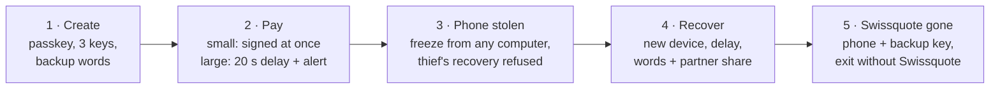
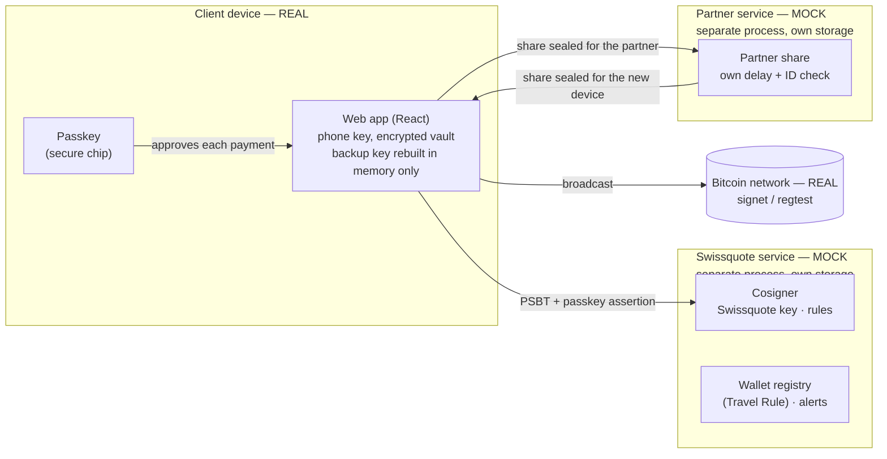

# Swissquote Wallet — collaborative self-custody for Bitcoin

> **Your bitcoins, your keys, one step away from your Swissquote account.**
> Swissquote protects you but can never move your funds without you — and if Swissquote disappears, you leave with them.

Submission for the **Swissquote Wallet Prize** (BSA hackathon, DoraHacks). Working prototype: a mobile web app, two mocked services that run as separate processes (Swissquote and an independent partner), and **real Bitcoin transactions** (regtest locally, **signet** in public).

| | |
|---|---|
| Full write-up (custody, threat model, legal, business) | [`swissquote-wallet/docs/10-dorahacks-submission.md`](swissquote-wallet/docs/10-dorahacks-submission.md) |
| Public proof on signet | [`3360d434…c534c62e`](https://blockstream.info/signet/tx/3360d434de9383653c896a925988c987110496b4c28c20f684441504c534c62e) — first 2-of-3 payment, phone key + Swissquote key |
| Demo video | *(link added at submission)* |
| Run it | [Quick start](#run-it-in-5-minutes) |

---

## The idea in 30 seconds

A **Bitcoin-native 2-of-3 multisig**. Any payment needs two signatures out of three keys:

| Key | Who holds it | Used for |
|---|---|---|
| **Phone key** | The client, on their device (encrypted, unlocked with the passkey) | Every payment |
| **Swissquote key** | Swissquote, as a cosigner that applies rules (limits, delays, sanctions, freeze) | Co-signing within the rules |
| **Backup key** | **Nobody in one piece.** Split with SLIP-39 into the client's share (paper words + encrypted cloud copy) **and** an independent partner's share | Recovery after phone loss, and leaving if Swissquote disappears |

- Daily use: **phone + Swissquote**. Swissquote can refuse or delay, never sign alone.
- Phone lost: **backup + Swissquote**, after a delay the real owner can cancel.
- Swissquote gone: **phone + backup**, no Swissquote involved at all.
- **Swissquote holds no part of the backup key**, so Swissquote, even together with the partner, cannot move or restore anything.

Same family as Bitkey, Casa and Unchained. No homemade cryptography.

## The demo story (create → sign → lose → recover)



| Step | In the app | Script (same scenario, against the real services) |
|---|---|---|
| Create a wallet | Log in → passkey (Windows Hello / Touch ID) → *Create your wallet* → write down and check 20 words → encrypted cloud copy | `npm run demo:create` |
| Small payment | *Send* → plain-language summary → *Approve with passkey* → signed by phone + Swissquote, broadcast | `npm run demo:cosign` |
| Large payment | Above the **instant payments** amount: held 20 s (24 h–7 days in production), alert, *Cancel payment* | `npm run demo:cosign` |
| Phone stolen | *Recovery → Freeze wallet* (also from the client area, without the phone) | `npm run demo:cosign` |
| Attacker with phone **and** email | Their recovery freezes the wallet and alerts the owner; without the paper words the backup key cannot be rebuilt; a sweep signed with the stolen phone key is refused | `npm run demo:recover` |
| Recover on a new device | *Recover your wallet* → 30 s delay at Swissquote and at the partner → enter words → new keys and new backup → funds move to the new wallet | `npm run demo:recover` |
| Swissquote disappears | Login screen → *Swissquote unavailable? Use your exit kit* → partner share + words → all funds sent with phone + backup key | `npm run demo:exit` (Swissquote service really stopped) |
| Trusted person (option) | *Recovery → Entrust it to a notary or a lawyer*: invitation link/QR, code check, partner destroys its copy | `npm run demo:trustee` |

## The six required topics

### 1. Custody model — and its threat model

**Chosen:** 2-of-3 multisig `wsh(sortedmulti(2, phone, swissquote, backup))`, backup key in SLIP-39 groups (CLIENT + PARTNER, both required). Rejected: custodial account (not self-custody), seed phrase alone (a bank client will not keep 24 words safe), plain 2-of-3 split backup (Swissquote + partner could restore without the client — the brief's grey zone, and Ledger Recover's controversy), MPC (risky to integrate in 33 h), ERC-4337 (EVM-only, while Swissquote's clients mostly hold BTC).

| Question from the brief | Answer |
|---|---|
| Can Swissquote, alone or with a partner, move the funds? | **No.** Swissquote has 1 key of 3 and no backup share; Swissquote + partner still lack the client's share |
| Who could lock the client out? | Nobody durably: phone + backup key spend without Swissquote |
| Who could steal funds? | Phone thief → capped by the instant amount (**fees included**), then delay + alert + freeze from any computer. Phone + email → recovery refused without the paper words. Stolen paper → still needs the partner (own delay) and Swissquote. Malicious employee → 1 key of 3 |

Full threat model (10 attackers, residual risks): [write-up §1](swissquote-wallet/docs/10-dorahacks-submission.md#1-custody-model-decision).

### 2. Architecture



Swissquote and the partner never talk to each other, and neither ever sees the client's backup words.

| Component | Status |
|---|---|
| 2-of-3 multisig, PSBTs, signatures, broadcast | **Real** — bitcoinjs-lib, bip32; regtest and signet |
| SLIP-39 backup with groups | **Real** — shamir-mnemonic-ts, passes the 45 official Trezor vectors and two-way interop with Trezor's Python reference |
| Share encryption | **Real** — WebCrypto (ECDH P-256 + HKDF + AES-GCM; PBKDF2 for the cloud copy) |
| Passkeys | **Real** — WebAuthn platform authenticator (SimpleWebAuthn), tested with Windows Hello |
| Swissquote service (login/KYC, cosigner, registry, alerts, recovery) | **MOCK** — separate process, own storage, key in a local file (HSM in production) |
| Partner service (backup share) | **MOCK** — separate process, own storage; the app never holds its share except sealed for the device during a recovery |
| Sanctions list, cloud storage of the backup copy, SMS/email | **MOCK** |

Every mocked response carries `"mock": true` and the app shows a permanent *Prototype* banner. Static version of the diagram: [`docs/architecture.svg`](swissquote-wallet/docs/architecture.svg).

### 3. Wallet creation

The client logs in with their Swissquote account (KYC reused, mocked), creates a passkey, and the **device** generates the phone key and the backup key. Swissquote derives a dedicated key for this client and **registers the wallet descriptor** — this links every address to the verified client. The backup key is split: the partner's share is sealed for the partner, the client's share is shown as 20 words (two are checked), then encrypted with a passphrase for the client's cloud; the backup secret is erased.

### 4. Authentication — small vs large payments

Every payment is approved with the passkey, and the WebAuthn challenge is **bound to the hash of that exact transaction** (single use): the biometric approves *this* payment, not a session. Swissquote re-checks the transaction independently of the app.

- **Instant payments** — up to 3,000 sats per 24 h in the signet demo (signet faucets give small amounts; a setting), **fees included**: signed at once.
- **Above** — not blocked: held for a security delay (20 s in the demo, 24 h to 7 days in production), with an alert; the client can cancel. The home screen shows what is left today.
- Protective actions (cancel, freeze) work with the passkey **or** the client-area session — a robbed client has no phone. Relaxing actions (unfreeze) need the passkey.

### 5. Recovery — including "Swissquote is gone"

- **Phone lost:** recovery from a new device freezes the wallet and alerts the owner; Swissquote and the partner each apply their **own** delay (30 s in the demo, 7 days in production) and identity check. The new wallet is created and backed up **before** any funds move; then the backup key (rebuilt on the device only) signs a sweep that Swissquote co-signs only if it pays the new wallet. Old passkeys are revoked. The real owner can cancel at any time; cancelling also stops the partner's release.
- **Attacker with the phone and the email** (bonus): refused — demonstrated step by step in `npm run demo:recover`.
- **Swissquote gone:** an exit flow that needs no Swissquote service (the screen only checks whether Swissquote still answers, to tell the client); phone key + backup key sign, broadcast directly to Bitcoin. The downloadable **exit kit** contains standard descriptors for Sparrow or Bitcoin Core.

### 6. Business case

Keeps self-custody clients inside the ecosystem instead of losing them to an external wallet; a paid "collaborative custody" tier (the model Casa and Unchained charge for); fewer lost-seed support cases; KYC reused, and Travel Rule checks become automatic. Hypotheses to validate with Swissquote data — [write-up §7](swissquote-wallet/docs/10-dorahacks-submission.md#7-business-case).

## Legal feasibility (custody and Travel Rule)

*Design reasoning, not legal advice.* Custody depends on who **can** move the funds: Swissquote cannot, alone or with the partner, so we expect it to act as a technical cosigner rather than a custodian — to be confirmed by a Swiss lawyer. **Travel Rule:** Swissquote co-creates the wallet and registers its descriptor after KYC, so ownership of every address is proven from day one, with no manual check. Details: [write-up §6](swissquote-wallet/docs/10-dorahacks-submission.md#6-legal-feasibility--custody-and-travel-rule).

## Bonus topics

| Bonus | Status |
|---|---|
| Recovery refusing an attacker with the phone and email | **Done**, demonstrated (`demo:recover`) |
| Compliant interaction | **Partial**: plain-language summary checked by the app and re-checked by Swissquote, sanctions screening (mocked list), delay and alert for high values. No dApp connection (native Bitcoin) |
| Gasless transactions | **Not implemented** (designed: Swissquote adds a fee input from its own wallet, with a quota) |

## Run it in 5 minutes

Requirements: Node.js 22. **No Docker needed**: the demo runs on **signet**, Bitcoin's public test network. All commands run in the inner `swissquote-wallet/` folder.

```bash
cd swissquote-wallet
npm install
cp .env.example .env      # BTC_NETWORK=signet by default
npm run dev:all           # Swissquote (4001) + partner (4002) mocks + app → http://localhost:5173
```

In the app: log in with any client ID, create the passkey and the wallet, then *Transfers → Get test bitcoin*, which gives you the address to fund from a signet faucet. Each server prints the network and `.env` file it uses at startup. Every transaction can be checked on https://blockstream.info/signet.

```bash
npm test                  # 79 automated tests (custody invariants, 45 SLIP-39 vectors, PSBT checks…)
```

The scenario scripts of the table above (`npm run demo:*`) need instant blocks: they run on an optional local regtest network (Docker, `npm run regtest:up`). Step-by-step guide with troubleshooting: [`docs/00-getting-started.md`](swissquote-wallet/docs/00-getting-started.md).

## How we checked it

- **79 automated tests**: no single key can finalize a transaction (Swissquote's included), the three legitimate key pairs can, one SLIP-39 group alone restores nothing, the 45 official SLIP-39 vectors, PSBT summary checks, encryption, wallet discovery.
- **Scenario scripts** against the running services on regtest, including attacks: huge-fee attack, foreign inputs, missing / swapped / replayed passkey, phone + email recovery, Swissquote stopped.
- **Real Windows Hello** for passkeys; **public signet** transaction above.
- A bug audit of the transaction and recovery paths, with fixes (e.g. funds now never move to a wallet that is not yet backed up, and a failed recovery sweep can be retried).

## What this is not (yet)

A prototype, not a product: the Swissquote key is a local file (HSM in production), KYC and alerts are simulated, delays are shortened, and the legal reading needs a Swiss lawyer. The production gap is listed in [`docs/06-prototype-to-production.md`](swissquote-wallet/docs/06-prototype-to-production.md).

## AI tools used

| Tool | What we used it for |
|---|---|
| **Claude Code** (Claude Opus) | Design discussions, writing the code (reviewed by the team), tests and demo scripts, bug audit, documentation; project skills encoding our rules (custody invariants, Bitcoin multisig, SLIP-39, mock services, demo, docs) |
| Claude — **Exa** connector | Research: libraries (bitcoinjs-lib, SLIP-39 implementations, SimpleWebAuthn), signet APIs and faucets, prior art (Bitkey, Casa, Ledger Recover, Nigiri) |
| Claude — **Figma** connector | Architecture diagram (FigJam) and the app mockups |
| **Claude in Chrome** | End-to-end testing of the web app and its animations in the browser |
| Claude Code `premium-ui` skill | Choosing animated components from Rare UI, then porting them to our styles |

## Repository map

| Path | What it is |
|---|---|
| `swissquote-wallet/packages/core` | Shared Bitcoin library: keys, descriptor, PSBT, SLIP-39 backup, encryption, chain client |
| `swissquote-wallet/apps/web` | The client app (Vite + React + TypeScript) |
| `swissquote-wallet/services/swissquote` | **Mock** Swissquote: login, passkeys, cosigner rules, registry, recovery |
| `swissquote-wallet/services/partner` | **Mock** partner holding the backup share; trusted-person option |
| `swissquote-wallet/scripts` | Replayable demo and attack scenarios |
| `swissquote-wallet/tools` | Optional local Bitcoin network (Docker), SLIP-39 interop check with Trezor's Python reference |
| `swissquote-wallet/docs` | Getting started, brief, decisions, prior art, production gap, build plan, submission write-up, proofs |
| `swissquote-wallet-design.md` | Full design document |

Credits: animations adapted from [Rare UI](https://www.rareui.com) (MIT); local Bitcoin setup adapted from Nigiri (Vulpem Ventures).
