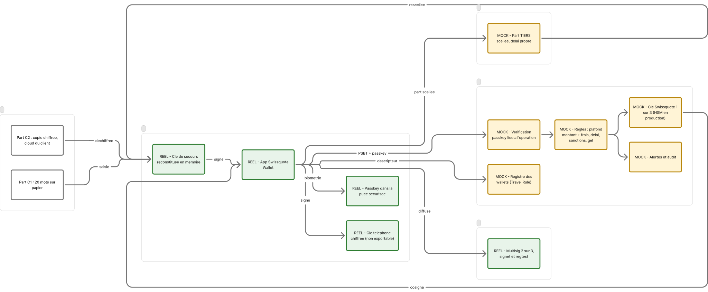

# swissquote-wallet (code)

The code of the self-custody wallet Swissquote could launch for its clients. A team of 3 for the BSA hackathon (DoraHacks), **Swissquote Wallet Prize** track, 33 hours.

> Presentation for the jury: the [README at the repository root](../README.md) and the full write-up [`docs/10-dorahacks-submission.md`](docs/10-dorahacks-submission.md). This file is the entry point for developers.

Demonstrated story: creation → login and signing → lost phone → recovery, with real transactions on **Bitcoin signet**, and the client's exit if Swissquote disappears.

## The idea in one sentence

A 2-of-3 Bitcoin multisig where the client holds two keys (phone and backup key) and Swissquote only one (a cosigner with limits and delays). The backup key is stored with SLIP-39 so that neither Swissquote, nor Swissquote together with the partner, can rebuild it.

## Architecture



Green: real. Yellow: mocked (separate process with its own storage). Rendered diagram with the data flows: [root README](../README.md#2-architecture).

## What is real and what is mocked

| Component | Status |
|---|---|
| 2-of-3 multisig, PSBTs, signatures, signet transactions | Real |
| SLIP-39 backup with groups, share encryption | Real (library validated against the official vectors) |
| WebAuthn passkeys | Real |
| Swissquote service (KYC, cosigner, notifications) | **MOCK**, separate process, own storage, key in a local file |
| Partner service (PARTNER share) | **MOCK**, separate process, own storage |
| Sanctions list, cloud storage of C2, banking continuity | **MOCK** |

Details and production requirements: `docs/06-prototype-to-production.md`.

## Contents

| Path | Role |
|---|---|
| `CLAUDE.md` | Context for Claude sessions |
| `docs/00-getting-started.md` | Step-by-step setup and troubleshooting |
| `docs/01-hackathon-brief.md` | Official brief and scoring |
| `docs/02-initial-design-superseded.md` | First design (ERC-4337), kept for reference |
| `docs/03-decisions.md` | Decisions, custody invariants, spike (**authoritative**) |
| `docs/04-prior-art.md` | Related projects (Bitkey, Casa, Ledger Recover…) |
| `docs/05-differentiation.md` | How we stand out |
| `docs/06-prototype-to-production.md` | Demonstrated, mocked, required in production |
| `docs/07-connectors-and-tools.md` | Connectors, skills, tools |
| `docs/08-technical-references.md` | Signet API, libraries, known pitfalls |
| `docs/09-build-plan.md` | Tasks per person and per phase |
| `docs/10-dorahacks-submission.md` | DoraHacks submission write-up |
| `docs/proofs.md` | Public transactions on signet |
| `../swissquote-wallet-design.md` | Full design document |
| `packages/core` | Shared library: keys, descriptor, PSBT, SLIP-39, encryption |
| `apps/web` | Mobile web app (Vite + React) |
| `services/swissquote` | Mock of the Swissquote cosigner |
| `services/partner` | Mock of the partner holding the PARTNER share |
| `tools/slip39-interop` | Check against Trezor's Python reference |
| `tools/regtest` | Optional local Bitcoin network (Docker) |
| `scripts/` | Replayable demo and attack scenarios |

## Scoring

Technical 35, security and custody 20, legal 15, business 15, UX and pitch 15, plus up to 20 bonus points if create → sign → recover works end to end.

## Getting started

Step-by-step guide: `docs/00-getting-started.md`. In short, in this folder:

```bash
npm install && cp .env.example .env   # BTC_NETWORK=signet by default: no Docker needed
npm run dev:all        # then open http://localhost:5173
npm test               # 79 tests
```

Fund the wallet from a signet faucet (*Transfers → Receive bitcoin* gives the address). Demo delays: 30 s for a recovery, 20 s for a large payment (7 days, and 24 h to 7 days, in production). For development, an optional local regtest network: `npm run regtest:up` (Docker) and `BTC_NETWORK=regtest`.
